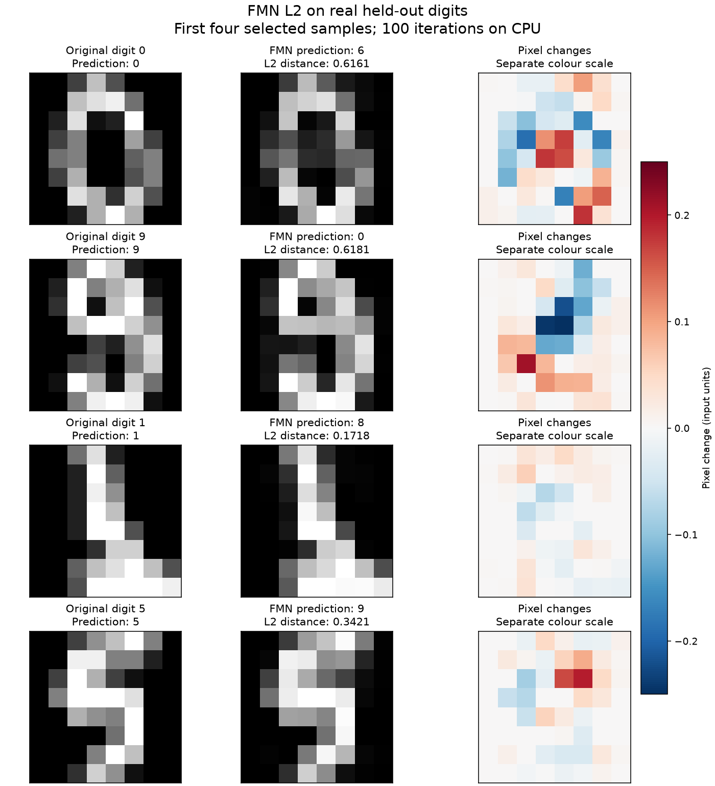
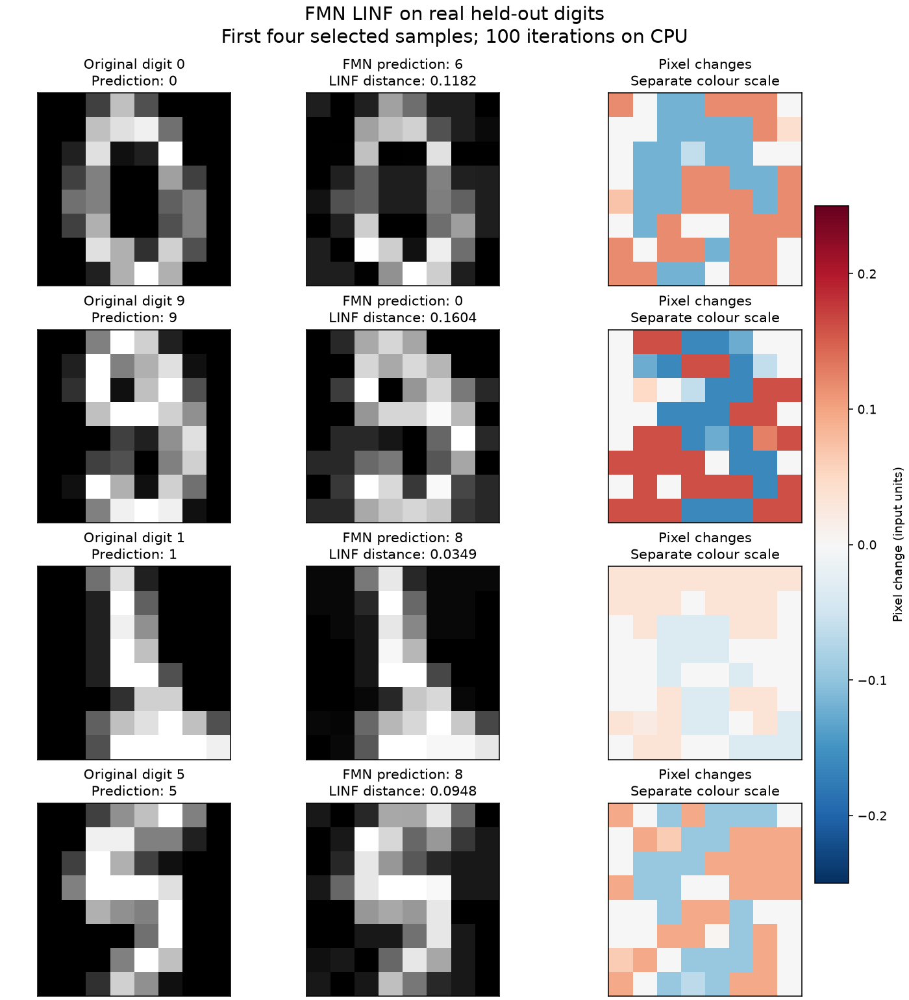
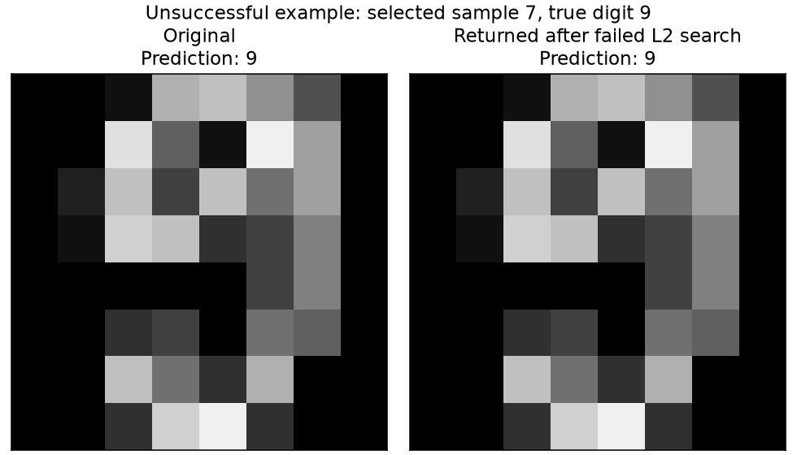

# FMN contribution — submitted upstream

Submitted on **27 October 2026**, after reviewing the implementation and drafts: [feature issue #2855](https://github.com/Trusted-AI/adversarial-robustness-toolbox/issues/2855), [PR #2856](https://github.com/Trusted-AI/adversarial-robustness-toolbox/pull/2856), and the [linking issue comment](https://github.com/Trusted-AI/adversarial-robustness-toolbox/issues/2855#issuecomment-6448868987). All three posts cite the original NeurIPS 2021 paper and include real digit samples. The PR is open; DCO passed. All 14 upstream CI workflows are awaiting maintainer approval (`action_required`), and maintainer review is pending.

[Implementation branch](https://github.com/daniyyell-dev/adversarial-robustness-toolbox/tree/feature/fast-minimum-norm) · [Attack code](https://github.com/daniyyell-dev/adversarial-robustness-toolbox/blob/feature/fast-minimum-norm/art/attacks/evasion/fast_minimum_norm.py) · [Tests](https://github.com/daniyyell-dev/adversarial-robustness-toolbox/blob/feature/fast-minimum-norm/tests/attacks/test_fast_minimum_norm.py) · [Runnable digits example](https://github.com/daniyyell-dev/adversarial-robustness-toolbox/blob/feature/fast-minimum-norm/examples/fast_minimum_norm_digits.py)

## What this adds

An ART-native NumPy implementation of the published [Fast Minimum-Norm attack (NeurIPS 2021)](https://arxiv.org/abs/2102.12827), using class-logit gradients. It supports L2 and Linf, targeted and untargeted attacks, batching and finite scalar or featurewise input bounds. It returns the smallest successful example encountered, or the original input when no successful example was found. This is an implementation contribution, not a claim to have invented the attack.

L0, L1, restarts and adversarial starting points are outside this initial scope. The attack follows the reference's evaluation order: the final gradient update is not evaluated for inclusion in the result. Small safeguards handle flat/non-finite gradients, float32 boundary rounding and bounded outputs. Logits and matching logit gradients are required; no softmax layer.

## Real data and results

The bundled scikit-learn handwritten digits dataset contains real 8×8 images. A seeded, stratified split uses **1,347 training samples and 450 held-out test samples**. A trained 64→32→10 tanh MLP correctly classified **431/450 (95.78%)** held-out images. Its fitted weights were copied to PyTorch for logits and autograd; all 450 clean predictions were checked against the fitted scikit-learn model.

We attacked the **first 100 correctly classified samples in the fixed held-out split**, with no selection based on attack outcomes. Targeted labels are `(true_label + 1) % 10`. Each attack used 100 iterations, max step 1, final step 0.01, gamma 0.05, pixel values in [0,1], and CPU.

| Mode | ART successes | Median successful norm | Author reference successes | Reference median norm |
|---|---:|---:|---:|---:|
| l2_untargeted | 82/100 | 0.502982 | 82/100 | 0.502980 |
| l2_targeted | 97/100 | 0.819099 | 97/100 | 0.818266 |
| linf_untargeted | 100/100 | 0.096243 | 100/100 | 0.096242 |
| linf_targeted | 100/100 | 0.164773 | 100/100 | 0.164940 |

These are small correctness/evaluation examples, not a reproduction of the paper's large benchmarks or a fixed-epsilon robust-accuracy claim. Norms are in normalized input units. Failure cases are included in success-rate denominators and excluded only from the explicitly labelled successful-norm medians. Outputs remained within [0,1].

The [authors' original source](https://github.com/pralab/Fast-Minimum-Norm-FMN-Attack/blob/98c68c26aaa72e4259634b94308b6a2db236a38a/src/attacks/fmn.py) was run on the identical PyTorch model, samples and settings. All four modes agreed sample-by-sample on success/failure. Median absolute per-sample norm differences were approximately 0.000001; trajectories are not bit-for-bit identical. Maximum targeted norm differences were 0.108775 (L2) and 0.014553 (Linf). Full metrics are in [results.json](digits-mlp/results.json); exact inputs, outputs and split indices are in [samples.npz](digits-mlp/samples.npz).

## Samples you can inspect

Each grid shows the first four selected samples, including the original prediction, the attacked prediction and the actual pixel changes. Original and attacked images share [0,1] grayscale; differences have a separate colour scale.

### L2 examples



### Linf examples



### A failed search

L2 untargeted search failed on 18/100 samples within this iteration budget. The implementation returns the original sample on failure; it does not report that unchanged sample as an attack success.



## Limitation retained from the investigation

A separate linear logistic-regression model achieved 433/450 clean accuracy, but L2 untargeted FMN found **0/100 successes** at these settings in both ART and the original author source. Clipping and local boundary estimates can cause the search to approach a decision boundary without crossing it; rounding safeguards do not eliminate this convergence limitation. This is recorded in [linear-model results](digits-linear/results.json), rather than omitted. No claim is made that FMN reliably defeats every model or that 100 iterations is sufficient.

The installed Foolbox 3.3.4 L2 class has a projection that does not use epsilon (`norms / norms`). Therefore the L2 baseline above is the original author's source, not the packaged Foolbox L2 class. Foolbox Linf is additionally exercised in the optional unit-test comparison. No upstream report about that separate observation has been posted.

## Validation

- Python 3.13.13: **9 test methods passed**, including analytical minimum-distance checks, multiclass targeting, image-shaped inputs, boundary rounding, flat gradients, invalid parameters, batching, no mutation and PyTorch integration. [Log](tests-python313.log).
- New attack module: **100% statement and branch coverage** (123 statements, 44 branches). [Coverage](coverage.json).
- Python 3.10.20 / NumPy 1.26.4: **8 passed, 1 skipped**; optional PyTorch test skipped because that environment has no PyTorch. [Log](tests-python310.log).
- Full-tree Ruff and changed-file Black/pycodestyle passed; targeted mypy passed; attack-module pylint scored 10/10. Pylint's pre-existing invalid `suggestion-mode` config option was disabled for this targeted check. Logs are alongside this page.
- Main evaluation: macOS 27.0, ARM64, PyTorch 2.13.0, NumPy 2.5.4, scikit-learn 1.9.1, Foolbox 3.3.4. CPU only; no GPU or full TensorFlow/Keras test suite was run. The optional Foolbox import emits an existing SciPy deprecation warning.

## Reproduce

Use the **implementation branch** for an upstream PR. The review branch adds evidence and drafts so you can read them here; those files are intentionally outside the implementation commit.

```bash
python -m unittest tests.attacks.test_fast_minimum_norm
python examples/fast_minimum_norm_digits.py --model mlp --samples 100 --steps 100 --output-dir /tmp/fmn-digits
```

For the original-source comparison, install `foolbox==3.3.4` and `eagerpy==0.30.0`, then use the reference file and licence provided in this review branch:

```bash
python examples/fast_minimum_norm_digits.py --model mlp --samples 100 --steps 100 --output-dir /tmp/fmn-digits --reference-source contrib/fmn-review/reference-fmn.py
```

Switch `--model linear` to reproduce the separate linear limitation. Run `render_samples.py` next to a `digits-mlp` output folder to recreate the figures (requires Matplotlib).

Reference provenance: commit `98c68c26aaa72e4259634b94308b6a2db236a38a`, Git blob `9690e2ef0f4fa211fa04c9aba7ada4acd5eaefcc`. The exact source hash is also in the result JSON. Maura Pintor's MIT copyright and licence are preserved in the adapted module and the [reference licence](reference-LICENSE).

## Reviewed submission drafts (historical)

1. [Feature issue draft](ISSUE_DRAFT.md), used as the basis of issue #2855.
2. [Pull request draft](PR_DRAFT.md), used as the basis of PR #2856; head `feature/fast-minimum-norm`, base `Trusted-AI/adversarial-robustness-toolbox:main`.
3. [Follow-up comment draft](COMMENT_DRAFT.md), posted with the actual PR link and paper citation.

PR #2856 has been opened and is awaiting upstream review. It has not been merged or accepted.
